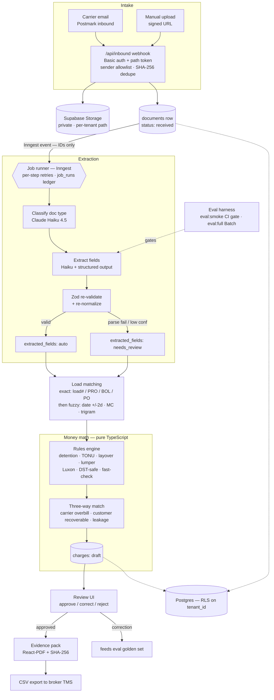

# DCMAI — Freight Accessorial Recovery Desk

> Find the accessorial charges freight brokers never billed — and the ones carriers overbilled — with Claude-powered document extraction, a deterministic money-math engine, and an audit trail a human can sign.

**Role: solo founder & full-stack engineer (architecture, data model, extraction, rules engine, evals) · Timeframe: Nov 2026 – present · Status: active development, private repo · Live: private beta (not yet public)**

---

## The Problem

A freight broker arranges a load between a shipper and a trucking carrier and lives on the spread. Beyond the base freight rate, loads accrue **accessorial** charges — *detention* (the driver waited too long at a dock), *TONU* (a booked truck was cancelled), *layover* (an overnight hold), *lumper* (third-party unloading labor). Carriers bill the broker for these, but the broker routinely forgets to rebill them to the customer, so the money quietly leaks out of the margin. The evidence that proves a charge — arrival and departure times — is usually **handwritten on a proof-of-delivery photographed on a phone**, buried across rate confirmations, bills of lading, and carrier invoices that arrive by email. Reconciling it by hand doesn't scale, so brokers leave real dollars on the table on every load.

## What I Built

- **Email-in document intake.** Carriers forward paperwork to a per-tenant, unguessable `{tenant}-{random}@in.<your-domain>` address. A hardened Postmark webhook authenticates every delivery (HTTP Basic + secret path token, constant-time compared), enforces a per-tenant sender-domain allowlist, deduplicates by SHA-256, and files each attachment into a private, tenant-scoped Supabase Storage path — treating every byte of the email as untrusted input.
- **Claude-based extraction, code-validated.** A durable per-document job classifies the doc type and extracts fields (load/PRO/BOL numbers, appointment and in/out times, rates, free-time terms) with Claude Haiku 4.5 **structured outputs**. Document text is passed as data — never the system prompt, never allowed to select tools. Every model result is re-normalized and re-validated against a Zod schema in code; on any parse failure the field routes to **`needs_review`**, never a guess.
- **A deterministic rules engine — LLMs never compute money.** All charge math lives in a pure TypeScript package (no I/O, no `Date.now()`): the detention clock, TONU, layover, and lumper. Timestamps are UTC instants converted through each facility's IANA timezone with Luxon; DST-ambiguous, nonexistent, and date-rolled wall times route to review instead of silently producing a four-figure charge off a transposed handwritten pair.
- **Three-way match that surfaces leakage.** For each load the engine computes what the broker legitimately owes the carrier (flagging carrier **overbills**), what the broker can **rebill the customer** (the recoverable), and the gap between them — the leakage report. Everything is a **draft charge**; a human approves, corrects, or rejects before anything is billed.
- **Signable evidence packs + TMS export.** Approved charges generate a React-PDF evidence pack (contract clause, timestamp table, computation trace, SHA-256 fingerprint) and a generic CSV mapped to the broker's TMS. Every correction an AR clerk makes feeds the eval golden set.
- **Multi-tenant isolation enforced, not assumed.** Every table carries `tenant_id` with row-level security; child rows are pinned to their parent's tenant via composite foreign keys so cross-tenant references are impossible even on service-role paths. An integration suite spins up two tenants and proves one cannot read, write, or download the other's data — across all tenant tables and Storage — with positive controls so a deny-everything policy can't pass by accident.

## Architecture

Ingestion, extraction, matching, and billing are decoupled as a durable pipeline: the inbound webhook only stores bytes and emits an event carrying **IDs, never document content**, and each stage writes a `job_runs` row so the ledger survives a change of job runner. The extraction, matching, rules, and billing packages are pure and framework-free — all Supabase wiring lives in the web app — so the dollar-affecting logic is unit- and property-testable in isolation, and the LLM is quarantined to "read this document and fill this schema."

## Tech Stack

- **Web:** Next.js 16 (App Router) · React 19 · TypeScript (strict) · Tailwind CSS 4 — review queue, ops dashboard, auth.
- **Data:** Supabase Postgres with row-level security · `pg_trgm` for fuzzy shipper matching · private Storage · SQL migrations as the only path to a cloud DB.
- **AI:** Claude Haiku 4.5 for classification + field extraction via the Anthropic SDK's **Zod structured outputs**; Claude Sonnet 5 wired for escalation/cost accounting. Per-call token/latency/cost captured for a gross-margin ledger.
- **Platform:** pnpm workspace monorepo (1 app + 7 packages) · Inngest for durable per-document jobs · Luxon for timezone-correct instants · React-PDF for evidence packs · Postmark inbound email · Vitest + fast-check (property tests).
- **Security:** tenant-scoped RLS + composite-FK tenant pinning · `service_role` confined to inbound + job handlers · untrusted-content handling (control-char scrubbing, content-type-derived file extensions, no document text in prompts) · supply-chain hardening in `pnpm-workspace.yaml` (install scripts blocked by allowlist, a 3-day `minimumReleaseAge`, a pinned `minimatch` override for a Dependabot GHSA).

## Highlights / Results

- **Money math is provably deterministic.** The rules and matching packages are pure functions tested with **fast-check** property tests (e.g. detention is monotonic in departure time, never negative, honors the daily cap, invariant under DST shifts), plus golden tests from real rate-con clauses. LLM output can never reach a dollar figure without passing through this engine.
- **Adversarially hardened timestamp handling.** Rather than trust Luxon to pick an instant, the engine detects spring-forward (nonexistent) and fall-back (ambiguous) wall times and date-rolled overnight dwells and routes them to human review — because an unconditional date-roll turns a transposed handwritten `in/out` pair into a bogus ~20-hour, four-figure charge.
- **Tenant isolation is a test, not a claim.** A dedicated RLS integration suite asserts cross-tenant denial for reads, writes, and Storage downloads across **7 tenant-owned tables**, with an unaffiliated signed-in user and an anonymous client, and positive controls proving legitimate access still works.
- **Correct-by-construction load matching.** Matching tries exact keys (load #, PRO, BOL, PO) before fuzzy scoring (date window, carrier MC, trigram shipper similarity). Identifier values from untrusted documents are bound as parameters — never spliced into PostgREST `.or()` filter strings — and an exact key hitting more than one load routes to review instead of corrupting dollars on two loads at once.
- **An eval harness that refuses to lie.** `pnpm eval:smoke` runs free in CI on cached/synthetic fixtures and is designed to report a fixture count rather than fabricate a green accuracy number; `pnpm eval:full` runs the Batch API overnight. Metrics are defined up front — **raw field accuracy** and **auto-accept precision/coverage**, reported per field × doc type × capture method — so the headline number can't be redefined after the fact.
- **AI-assisted engineering with guardrails.** Built solo with Claude Code under a hard-rules `CLAUDE.md`, pre-commit hooks, deny rules, and a `/code-review` subagent pass per slice — with a documented security posture (prompt-injection mitigations, 2026 npm supply-chain defenses, agents never touching production).

## Screenshots

> Add real captures to `assets/` and they will render below.

---

*Built as a focused, eval-gated solo project. Architecture, data flow, and features are described here in prose and diagrams; no proprietary source, customer data, or credentials are included.*
